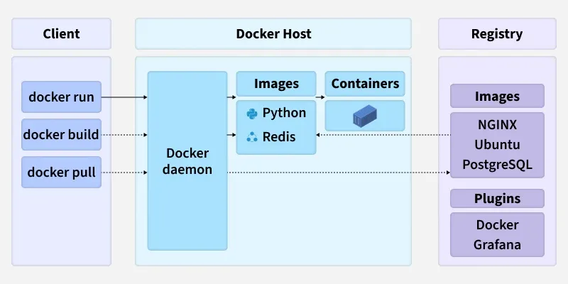
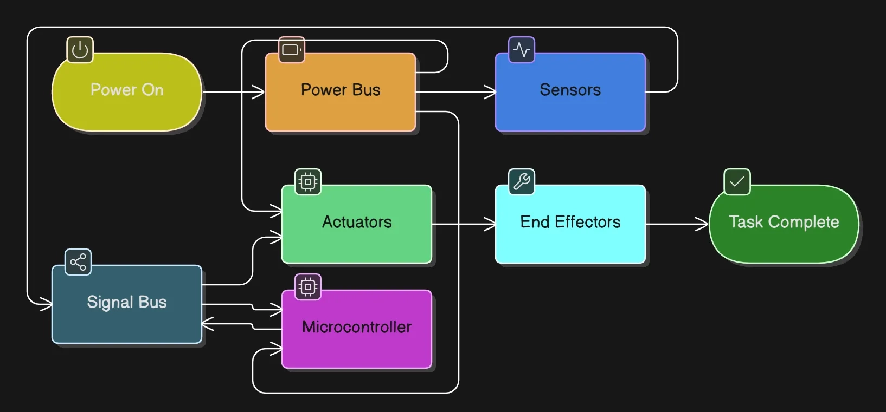
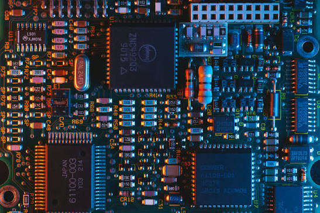
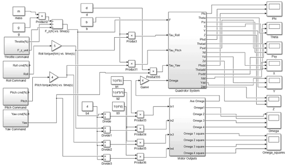
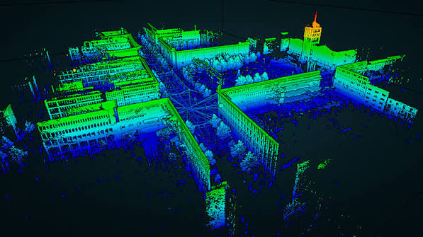
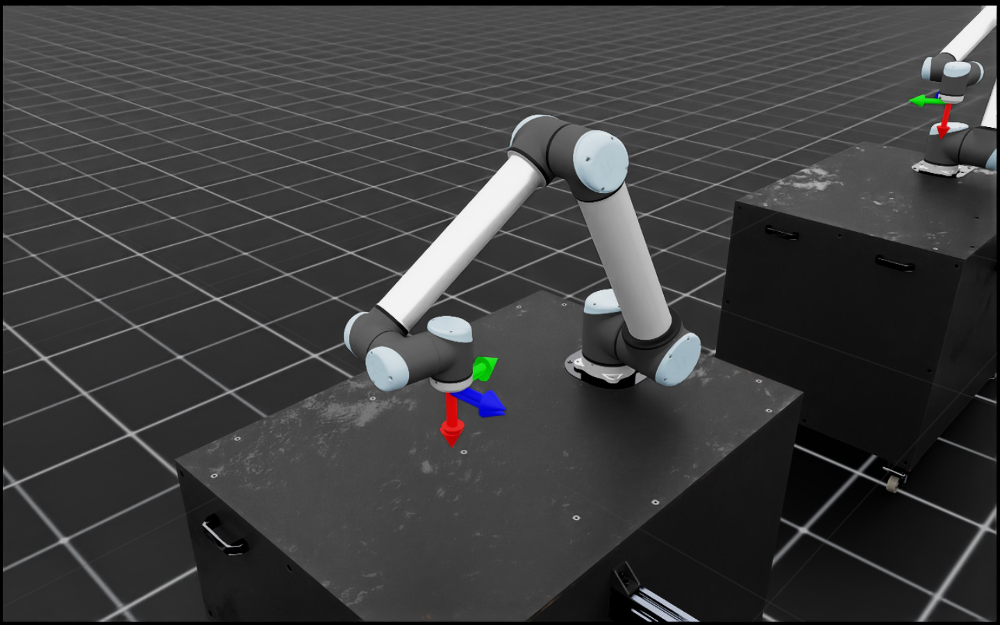

<div align="center">


# Robotics Club — IIT Jodhpur

**Official website of the Robotics Society, IIT Jodhpur.**  
Building autonomous systems, intelligent drones, and state-of-the-art robotic solutions.

[](https://RoboticsClubIITJ.github.io)
[](https://nextjs.org)
[](https://www.typescriptlang.org)
[](https://tailwindcss.com)

</div>

---

## Overview

This repository contains the source code for the official website of the **Robotics Club, IIT Jodhpur**. The site is built as a fully static Next.js export, deployed automatically to GitHub Pages on every push to `main`.

The site covers:
- **Projects** — Ongoing and completed robotics research projects
- **Team** — Current coordinators, core team, and mentors
- **Alumni** — Distinguished alumni and their current positions
- **Blogs** — Technical articles, tutorials, and knowledge-base posts authored by club members
- **About & Contact** — Club information and ways to reach us

---

## Tech Stack

| Layer | Technology |
|---|---|
| Framework | [Next.js 16](https://nextjs.org) (App Router, static export) |
| Language | TypeScript 5 |
| Styling | Tailwind CSS 4 |
| Animations | Framer Motion |
| 3D Scene | Spline |
| Blog engine | Markdown (`gray-matter` + `react-markdown` + `rehype-highlight`) |
| Deployment | GitHub Pages via GitHub Actions |

---

## Project Structure

```
.
├── content/
│   └── blogs/              # Blog posts as Markdown (.md) files
├── public/
│   ├── blogs/              # Blog post assets (thumbnails, inline images)
│   ├── logo.png            # Site favicon / tab icon
│   ├── robosoc_logo.png    # Navbar logo
│   └── StartVideo.mp4      # Hero background video
├── src/
│   ├── app/                # Next.js App Router pages
│   │   ├── blogs/          # Blog listing + individual post renderer
│   │   ├── projects/       # Projects page
│   │   ├── team/           # Team page
│   │   ├── alumni/         # Alumni page
│   │   ├── about/          # About page
│   │   ├── contact/        # Contact / Join Us page
│   │   ├── layout.tsx      # Root layout (navbar, footer, background video)
│   │   └── page.tsx        # Home page (hero, updates marquee, projects preview)
│   ├── components/
│   │   ├── Navbar.tsx
│   │   ├── Footer.tsx
│   │   └── ui/             # Reusable UI primitives (buttons, cards, spotlight…)
│   └── lib/
│       ├── blogs.ts        # Blog frontmatter parsing utilities
│       ├── data.ts         # Site-wide data: projects, team, alumni, config
│       └── utils.ts        # Tailwind class helpers
├── next.config.ts
└── CONTRIBUTING.md
```

---

## Blog Assets

<table>
<tr>
<td align="center"><br/><sub>Docker Architecture</sub></td>
<td align="center"><br/><sub>ROS Architecture Basics</sub></td>
<td align="center"><br/><sub>Embedded Systems</sub></td>
</tr>
<tr>
<td align="center"><br/><sub>Control Systems</sub></td>
<td align="center"><br/><sub>SLAM</sub></td>
<td align="center"><br/><sub>Robotic Arm (Bob Ross)</sub></td>
</tr>
</table>

---

## Running Locally

```bash
# Clone the repo
git clone https://github.com/RoboticsClubIITJ/RoboticsClubIITJ.github.io.git
cd RoboticsClubIITJ.github.io

# Install dependencies
npm install

# Start the development server
npm run dev
```

Open [http://localhost:3000](http://localhost:3000) in your browser.

```bash
# Production build (static export to /out)
npm run build
```

---

## Deployment

The site is automatically built and deployed to **GitHub Pages** on every push to `main` via the workflow at [`.github/workflows/nextjs.yml`](.github/workflows/nextjs.yml).

> **Do not push directly to `main`.** All changes must come through a Pull Request.

---

## Contributing

We welcome content contributions from club members and collaborators. Please read [**CONTRIBUTING.md**](CONTRIBUTING.md) before opening a Pull Request.

---

<div align="center">

Made with ❤️ by the Robotics Club, IIT Jodhpur · [robotics@iitj.ac.in](mailto:robotics@iitj.ac.in)

</div>
